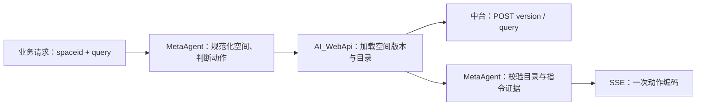

# MetaAgent 业务接口设计冻结文档 v1.0

文档日期：2026-11-07。核查基线：`832bca264bbc753ed119afae7288b255693c7256`。本地修复及验证记录见第 11 节。

**冻结对象是业务侧已经发送的请求、已经消费的响应，以及升级时必须保持的兼容行为。** 修复前 dev 的差距见 [接口核查及提交归因](interface-audit-20261107.md)。第 9 节保留原验收证据，第 11 节记录本次修复结果。本文不代表测试服已经修复或完成业务签字验收。

## 1. 范围与证据等级

本版覆盖：中台到 MetaAgent 的聊天入口、SSE/阻塞响应、空间及角色字段、场景动作、会话续聊与历史入口；同时规定场景后端的服务间边界与部署依赖。

- **业务实测**：验收工作簿中有请求或响应记录，例如 `spaceid`、无 `sceneVersion`、SSE、旧会话续聊预期。
- **代码确认**：本地源码或离线诊断可确定，例如字段长度、预览工具不交付动作、POST 场景目录查询。
- **冻结设计**：为保持业务行为而明确的实现要求，例如服务端补齐版本、旧会话经归属验证后兼容。
- **待实测/待确认**：没有完整成功报文或外部状态证据，不得宣称已经上线支持。

患者数据 v2、医院运营报表、问诊房间的各类临床事件保留各自契约，本次不从普通问答/导航的 11 条用例推导这些业务全部通过。内部迁移不得将 `patient_identity`、`identity_context_token`、`sceneVersion` 等字段追加为本版普通问答和场景导航的必填项。

## 2. 固定入口与认证

| 项目 | 冻结规格 | 证据 |
| --- | --- | --- |
| 业务聊天入口 | `POST /v1/chat-messages` | T04、T05、T07–T11 |
| 内容类型 | `Content-Type: application/json`，UTF-8 | 代码确认 |
| 服务认证 | `Authorization: Bearer <接入方令牌>` | T04/T05 无令牌及错误令牌均 401 |
| 主模式 | `response_mode=streaming`，响应为 `text/event-stream` | T07–T10 |
| 阻塞模式 | `response_mode=blocking`，响应为 JSON | 代码和现有离线测试确认；附件未验收 |
| 兼容别名 | `/compat/dify/v1/chat-messages` 保留相同 Dify 契约 | 代码确认 |
| 健康检查 | `GET /health/live`、`/health/ready`、`/health/dependencies` | T01–T03 |

主机、端口是环境配置，不写死为协议的一部分。附件记录的入口端口是 5080；更换端口或反向代理必须协调调用地址，不能作为请求字段变化的理由。

primary / secondary 是服务接入身份，`user` 是最终用户标识，两者不能混用。令牌轮换应保持同一接入方身份映射；切换 primary/secondary 会影响当前代码的会话归属，需要明确迁移。

业务继续使用 `/v1/chat-messages`。`/v1/chat` 存在按 `request_id` 区分 Native/Dify 的协议分流，不作为本版业务主入口；`/compat/dify/v1/workflows/run` 当前返回 501，不在本版支持范围。

## 3. 聊天请求

### 3.1 顶层字段

“必填”是协议义务；“样本出现”不代表所有请求都必须携带该字段。

| 字段 | 类型 | 必填与缺省 | 冻结规则 |
| --- | --- | --- | --- |
| `query` | string | 必填、去空白后非空 | 本轮自然语言。当前服务默认长度上限 4000，模型 schema 上限 32000；实际发布值必须随部署公布，不得静默下调 |
| `user` | string | 必填、非空 | 可信接入方注入的稳定用户 ID，最长 160；保持字符串，不把账号前导零转换掉 |
| `inputs` | object | 可省略，默认 `{}` | 空间相关业务应带当前空间；按下表解释 |
| `response_mode` | string | 默认 `streaming` | 仅 `streaming` / `blocking` |
| `conversation_id` | string | 可省略，默认 `""` | 空值表示新会话；续聊传服务返回的 ID。最长 160。ID 为不透明字符串，调用方不得依赖其前缀 |
| `files` | array | 可省略，默认 `[]` | 本版仅支持空数组；非空文件请求 422，不假装已处理附件 |
| `request_id` | string | 可省略，服务生成 | 若提供则非空、最长 160，用于同一逻辑请求幂等。业务原样请求不需增加此字段 |
| `auto_generate_name` | boolean | 可省略，默认 `true` | 保留兼容受理；不承诺每次请求都发生模型命名 |

`null` 不等同空字符串；`conversation_id: null` 不属于已冻结的新会话写法。顶层未知字段按现有 Dify schema 忽略，但不能由此获得额外能力或权限。

### 3.2 `inputs` 字段与兼容

| 字段 | 业务侧实际情况 | 冻结规格 | 基线状态／本地修复 |
| --- | --- | --- | --- |
| `spaceid` | T07–T11 使用此拼写 | 保留为业务输入；与 `spaceId`、`space_id` 等价；空间知识/场景动作按此空间限定 | 基线不识别；本地已恢复 |
| `identity` | 样本为 `医生` | 保留中文角色。`医生`/`doctor`/`clinician` 对应 `clinician`，`患者`/`patient` 对应 `patient` | 本地支持上述兼容映射 |
| `role` | 样本未传 | 可选扩展，合法值 `patient` / `clinician` / `operator`；现有代码显式 role 优先，发布时不得静默改变优先关系 | 不得要求中台改用 role 才能聊天 |
| `pos` | 样本为 `二楼 问诊中心` | 字符串，表示当前位置；包含连续文本 `问诊房间` 才进入问诊分支，其余走默认分支 | 当前支持；问诊中心不等于问诊房间 |
| `timestamp` | 样本为字符串 `1700.01` | 可选，作为调用方关联值回传；不得重新解释为服务端时间或重新计时 | 当前普通场景支持 |
| `requesterphone` | 样本是账号形态，并非 11 位手机号 | 保留旧业务名称，按不透明标识处理，不能强制手机号正则，也不能当作服务认证凭据 | 普通场景不依赖；问诊流程按既有字段透传 |
| `apikey`、`apitoken` | 样本携带、已脱敏 | 保持兼容受理；不替代 HTTP Bearer；不向回答、事件入参或持久化历史回显 | 当前 dev 未用这些 inputs 配置场景服务 |
| `companykb`、`maxkapp`、`maxkbauth` | 样本携带 | 保持兼容受理；不要求业务删除。当前知识源由服务配置及空间选择，不承诺按这些字段动态改源 | 不能把“字段被接收”当成“指定知识源已生效” |
| `sceneVersion` / `scene_version` | 样本均未传 | **可选**。提供时接受非负整数或现有实现支持的纯数字字符串，规范化为整数；拒绝布尔值、负数。未提供时由服务端查询目录版本 | 基线解析工具要求必填；本地已改为可选并绑定后端版本 |
| `tenantId` / `tenant_id` | 样本未传 | 可选，缺省使用接入环境配置；不能从自由文本猜测 | 当前支持 |

冻结设计：空间别名先取有效值并规范化为一个内部 `space_id`；空别名不能遮蔽另一个有效别名。若多个非空别名相互矛盾，应返回明确的 422，而不是跨空间猜选。持久化采用规范化空间值或兼容旧字段，不能只修本轮解析而继续丢失会话元数据。

没有当前空间时，不允许自动套用某个其他机构的固定默认空间。缺少患者身份只影响需要患者事实的工具，不应阻断普通问候、已授权空间知识或场景导航。

### 3.3 业务原样请求模板

下面保留附件字段形状，所有标识和凭据改为合成占位值；不是可直接访问真实业务的凭据。

```json
{
  "query": "带我去三楼。",
  "response_mode": "streaming",
  "conversation_id": "",
  "user": "business-user-001",
  "inputs": {
    "spaceid": "space-demo",
    "apikey": "<legacy-api-key>",
    "apitoken": "<legacy-api-token>",
    "companykb": "<legacy-company-kb>",
    "maxkapp": "<legacy-maxkb-app>",
    "maxkbauth": "<legacy-maxkb-auth>",
    "timestamp": "1700.01",
    "identity": "医生",
    "pos": "二楼 问诊中心",
    "requesterphone": "requester-account"
  },
  "files": []
}
```

兼容验收必须使用以上“仅小写空间字段、不传版本、不传患者 v2 身份、不传 request_id”的形状。不得为使测试通过而擅自补成开发夹具的 `spaceId + scene_version=7`。

## 4. SSE 与阻塞响应

### 4.1 SSE 帧

数据帧为 `data: <JSON>\n\n`。保活帧为 `event: ping\n\n`。客户端按事件流解析，不依赖一次网络读取恰好对应一帧。

正常 agent 流程的相对顺序为：`workflow_started`，零组或多组 `node_started/node_finished`，一条或多条 `message`，`workflow_finished`，`message_end`。消息可以随工具和动作完成分段发出，不固定 message 数量。

| 事件/字段 | 冻结语义 |
| --- | --- |
| `event` | 事件类型 |
| `task_id` | 本次运行标识，关联服务运行记录 |
| `message_id` / `id` | 消息标识，不作为动作编码，不假定与 task_id 相同 |
| `conversation_id` | 本次实际使用的会话，后续请求使用此值 |
| `message.answer` | 有序文本片段，可包含本版标记；客户端逐片拼接，不能只保留最后一片 |
| `workflow_finished.data.status` | 工作流聚合状态，当前代码将 partial 也映射为 succeeded |
| `message_end.metadata.status` | 内部终态，区分 succeeded / partial / unavailable / clarification / failed 等；业务不能只判断 HTTP 200 |
| `message_end.metadata.action_delivery` | 动作交付状态映射，不证明前端动作已执行完成 |
| `error` | SSE 建立后的执行错误事件；HTTP 流已开始时不再假装能改写 HTTP 状态 |

答复片段的最小示意（合成值，省略部分公共字段）：

```text
data: {"event":"message","task_id":"run_demo","message_id":"msg_demo","conversation_id":"conversation_demo","answer":"[timestamp=1700.01]"}

data: {"event":"message","task_id":"run_demo","message_id":"msg_demo","conversation_id":"conversation_demo","answer":"[Answer:]已查到当前空间的相关介绍。"}

data: {"event":"message_end","task_id":"run_demo","message_id":"msg_demo","conversation_id":"conversation_demo","metadata":{"status":"succeeded","action_delivery":{}}}

```

片段边界可能变化，时间戳与正文可能分帧；组合后的标记含义不得变化。`workflow_finished.outputs.answer` 是汇总文本，不能作为再次执行动作的通道。

### 4.2 业务输出标记

| 标记 | 规格 | 验证状态 |
| --- | --- | --- |
| `[timestamp=<原值>]` | 普通场景关联输入 timestamp；未提供时不强加 | T07–T10 响应摘要可见 |
| `[Answer:]` | 面向用户的答复正文 | T07–T10 可见 |
| `[Telepor:]<数字>` | 传送动作；保留既有 `Telepor` 拼写 | 代码确认，真实成功导航尚未验收 |
| `[ScenePoint:]<数字>` | 场景点动作 | 代码确认 |
| `[ClickPoint:]<数字>` | 点击/界面动作 | 代码确认 |
| `[GamePoint:]<数字>` | 训练/游戏点动作 | 代码确认 |
| `[Cweb]`、`[web]` | 现有报告图片/页面输出扩展 | 保持既有实现，本次样本未验收 |

场景命令必须来自已验证目录，不能由 LLM 生成数字 ID。无匹配、歧义、上游失败时不得输出可执行编码。

SSE 场景动作使用 `message.answer` 输出编码，并携带 `action_id`、`command_order`；同次动作只交付一次。匹配成功、已经写入输出通道、前端完成动作是不同状态。服务尚无已验证的前端完成回执时，不宣称“已到达三楼”。

### 4.3 阻塞与重试

阻塞响应保留 `event=message`、`task_id`、`message_id`、`conversation_id`、`mode=chat`、`answer`、`metadata`、`created_at`。首次阻塞响应可以在 answer 中包含本轮动作编码。复用 request_id 的快照及历史读取不得重放动作。

显式 request_id 对同一作用域、同一逻辑请求可用于幂等；改变请求内容而复用该 ID 返回 409。省略 request_id 时，每次 HTTP 请求是新请求，不能承诺自动去重。当前实现复用仍在运行的请求可返回 202 JSON；即使最初请求为 streaming，客户端也应先检查 HTTP 状态和 Content-Type。

## 5. 场景接口与版本责任

### 5.1 业务侧不承担内部目录版本升级



冻结设计：

1. `sceneVersion` 缺失时，服务端查询当前空间目录并取得有效版本；不得让用户手工补内部版本号。
2. 当前动作绑定本次返回的空间、目录版本、原话片段与指令证据。缺少调用方版本不意味着取消这些校验。
3. 调用方显式传入版本时，发生不一致应澄清或拒绝本次动作，不得静默改成最新版本继续执行。
4. 跳转使场景上下文失效后，后续动作按新上下文重新核验；不得机械重放原场景后续编码。
5. `resolve_scene_instruction` 是内部预览工具；明确动作请求应进入 `navigate_scene` 执行路径。不能把预览成功当作业务导航成功。

当前部署补丁描述为“未知版本时跳过比对”，这只能解释临时放行方式；正式实现需要补齐同次证据绑定，不能把附件的补丁描述直接当成冻结实现。

### 5.2 MetaAgent → AI_WebApi

现有目标路径：`POST /api/ai/rehab/tools/navigate_scene`，JSON，请求由服务端发起。使用服务端配置的 Bearer，不要求业务前端持有该服务令牌。

无调用方版本的冻结请求：

```json
{"target":"带我去三楼。","spaceId":"space-demo"}
```

显式已知版本时可增加 `expectedSceneVersion`，类型为非负整数。配套 C# 控制器已将此字段定义为可选，本次 MetaAgent 修复已按此适配；未提供时省略字段。

成功返回的最小语义示例（合成点位 ID，不可用于真实执行）：

```json
{
  "status": 200,
  "data": {
    "spaceId": "space-demo",
    "version": 7,
    "commands": [
      {
        "order": 1,
        "sourceText": "带我去三楼。",
        "status": "matched",
        "result": "[Telepor:]2",
        "intentType": "telepor",
        "candidates": []
      }
    ]
  }
}
```

`status` 为数值型业务封套；`version` 为非负整数；`commands` 按原话顺序排列。单条状态为 `matched`、`ambiguous` 或 `unmatched`；非 matched 的 `result` 必须为空。Agent 校验空间、版本、顺序、原话覆盖、指令格式及证据时效。

配套代码的失败路径：请求无效 400、显式版本冲突 409、场景目录/上游异常 502。这是服务间 HTTP 状态，不能与外层已建立的聊天 SSE 的 HTTP 200 混用。

### 5.3 AI_WebApi → 场景目录

源码确认的目录调用为 POST：版本请求 body 为 `{"spaceId":"<空间>"}`；目录查询 body 为 `{"sql":"<固定模板生成的只读查询>"}`；认证头为 `apikey` 和 `apitoken`。

目录返回结构：版本在 `data` 中；目录条目在 `data.result` 数组中，包含 `id`、`name` 及可选 `intro`。零条目可能返回 `data.result=null`。前端命令 ID 是既有目录数组序号，须保留协议含义。

以下配置属于 **AI_WebApi** 的部署责任：

| 配置 | 用途 |
| --- | --- |
| `RehabTools:Scene:VersionUrl` | 空间版本查询地址 |
| `RehabTools:Scene:QueryUrl` | 目录只读查询地址 |
| `RehabTools:Scene:ApiKey` | 目录调用认证 |
| `RehabTools:Scene:ApiToken` | 目录调用认证 |

在 .NET 环境变量中对应双下划线命名，例如 `RehabTools__Scene__VersionUrl`。旧 MetaAgent 的 `META_AGENT__SCENE_BACKEND_API_KEY/TOKEN` 或请求 inputs 中的同名概念，不能自动满足 AI_WebApi 配置。

真实地址可达性、凭据有效期、续期方式以及测试服镜像版本仍待外部实测。不得在未确认前把 token 的有效期写为永久，也不得要求业务通过聊天文本补凭据。

## 6. 会话及历史兼容

### 6.1 冻结行为

- 新会话：传空 `conversation_id`，返回新 ID；业务后续使用响应里的实际 ID。
- 同一业务身份、同一上下文续聊：有效 ID 应复用历史，T08→T10 已记录成功。
- 升级兼容：仍在有效保留期、能确认归属和授权的旧 ID 应经服务端迁移或映射继续使用，不能仅因内部命名空间改版就要求所有客户端清空 ID。
- 不存在、过期或越权 ID：保持明确错误，不恢复他人历史，不对所有未知 ID 静默新建。
- 若无法迁移，需明确返回不可恢复状态，并由调用方按既定流程新建，不能把空历史当成旧会话已恢复。附件中的 T11 仍是未满足项。
- 普通场景与问诊房间保持隔离；切换目标患者或问诊上下文可以返回不同会话 ID，业务必须更新保存值。

本次修复增加了普通旧会话的延迟迁移：聊天续聊、历史列表或消息查询时，验证旧用户索引、租户、角色、旧线程指纹与保留期，再将普通对话复制到新作用域，保持原 ID。旧索引没有接入方字段，须由部署配置 `META_AGENT__LEGACY_CONVERSATION_CLIENT=primary` 或 `secondary` 明确旧实例所属接入方；默认空值关闭迁移。

只迁移可验证的普通对话文本，丢弃旧工具消息、证据与待执行动作。旧患者绑定、问诊房间、带临床变量或记录引用的历史不自动迁移；这些数据需要另行建立新授权。未知、过期、归属不符或损坏的记录保持 404。不能仅凭 ID 查全库归并，也不能将混有多个接入方的数据集整体认作一个接入方。

### 6.2 历史入口

| 接口 | 现有参数 | 返回 |
| --- | --- | --- |
| `GET /v1/conversations` | `user` 必填；`limit=20`、`last_id` 可选；另支持 tenant_id、role、identity | `limit`、`has_more`、`data[]`，条目含 id/name/inputs/status/created_at/updated_at 等 |
| `GET /v1/messages` | `user`、`conversation_id` 必填；limit、first_id/last_id 可选；另支持 tenant_id、role、identity | `limit`、`has_more`、`data[]`，条目含 query/answer/conversation_id 等 |
| `POST /v1/conversations/query` | body 为 `user + inputs`，limit 为查询参数 | 同类列表，可携带完整身份上下文 |
| `POST /v1/messages/query` | body 为 `user + inputs`，conversation_id 等为查询参数 | 同类消息列表 |

当前 limit 被约束在 1–100。GET 样本仅证明 `user + limit` 被受理且返回空数组，没有证明医生历史可见。

本次采用服务端恢复已登记身份的兼容方式：GET 未传 `role` 和 `identity` 时，只在同一接入方、用户、租户内查找授权作用域匹配的历史；唯一角色可直接恢复，无匹配时列表为空、消息查询 404。多个角色同时匹配时，列表返回 422、`detail.code=history_identity_required`，由可信网关传已有 `role` 或 `identity` 选择，不合并多个角色的数据。指定会话 ID 的消息查询可以根据该 ID 的唯一归属确定角色。显式 `role` 仍优先于 `identity`。

患者 v2 授权不会由上述 GET 推断或补发；携带患者上下文的历史继续使用 POST 查询入口，并提供完整有效身份。该策略已离线验证医生普通历史可见、角色/用户/租户/接入方隔离；真实历史页仍须联调验收。

## 7. 错误与业务成功判定

| 情形 | 外层响应/处理 | 验收要求 |
| --- | --- | --- |
| 缺失或错误服务令牌 | HTTP 401 | 不启动业务执行 |
| 请求字段无效 | HTTP 422 | 指明字段或参数问题 |
| 无效/越权会话 | HTTP 404；聊天错误代码 `conversation_not_found` | 与可迁移的合法旧会话区分 |
| 未指定身份且历史列表匹配多个角色 | HTTP 422；`history_identity_required` | 明确选择已有角色，不聚合跨角色历史 |
| request_id 内容冲突 | HTTP 409；`idempotency_conflict` | 不重复动作 |
| 上游导航失败，SSE 已建立 | 外层可保持 HTTP 200；终态 unavailable/failed 等，无可执行编码 | 不按 HTTP 200 或有答复文本判成功 |
| 导航仅匹配成功 | 不等同动作交付成功 | 必须进一步确认执行路径产出动作帧 |
| 动作已交付输出通道 | 可记录 delivery_unknown 等交付状态 | 前端未确认前不声称执行完成 |

聊天早期错误当前常见形式为 `{"detail":{"code":"...","message":"..."}}`；认证错误的 detail 可能是字符串，Pydantic 字段错误是列表。v1 不静默统一成另一种外壳，消费方应按现有错误结构处理；若要统一，须另行做版本兼容。

## 8. 部署与配置约束

1. 空间知识源须显式配置合法 `allowed_space_ids`。当前非空校验属于服务配置，不转化为业务新增请求字段；空白名单不得解释为允许所有医院。
2. 需要交付场景动作时启用 `scene_enabled` 和 `scene_actions_enabled`，并确保接入方未排除执行工具。
3. 发布同时记录 MetaAgent、AI_WebApi 的 Git 提交和镜像摘要，以及配置版本。仅记录 MetaAgent 提交不足以证明上下游契约一致。
4. 部署补丁应收口到版本化代码，不能以“旧 env 已复制”“健康检查通过”替代依赖验收。
5. `/health/dependencies` 的 reachable 只代表探测地址可达；场景目录配置、认证、匹配和交付另做专项验收。
6. 业务凭据不进入公开文档、最终答复或持久化的可读输入；保留必要的非敏感关联字段用于审计。
7. 旧会话迁移配置见 `.env.example` 的 `META_AGENT__LEGACY_CONVERSATION_CLIENT`。仅在能够确认旧数据库接入方归属时启用，且须继续使用含有未过期旧索引和历史的同一数据存储。该项是服务部署配置，不是业务请求新增字段。

## 9. 冻结验收矩阵

| 编号 | 固定输入/场景 | 必须验证的结果 | 原验收证据／修复前状态 |
| --- | --- | --- | --- |
| F01 | 附件形状的新会话问答，仅 spaceid、无版本 | 200，有 answer，有终态与新会话 ID | 补丁版 T07 通过；干净 dev 空间别名不符 |
| F02 | 空间知识问答，沿用 spaceid | 命中当前空间已发布资料，来源正确 | 补丁版 T08 通过；仓库需恢复兼容 |
| F03 | 同空间的 spaceid / spaceId / space_id 三种写法 | 行为等价，元数据不丢空间 | 当前小写别名失败 |
| F04 | `带我去三楼`，不传 sceneVersion | 服务解析版本，输出一次合法动作帧 | 当前不满足；附件 T09 失败 |
| F05 | 合法匹配、明确执行意图 | 不能止于 preview succeeded；执行路径有 action_id | 离线已证明预览与执行差异，真实链路待测 |
| F06 | 显式错误版本、歧义点位、否定操作 | 不输出动作编码，说明需刷新/澄清 | 现有离线用例覆盖相关保护 |
| F07 | 同一有效会话追问 | 保留可见历史并返回正确 ID | 补丁版 T10 通过 |
| F08 | 有归属证据的旧会话 ID | 迁移或兼容恢复；越权 ID 仍拒绝 | 当前未完成；T11 为 404 |
| F09 | 医生聊天后查询历史列表 | 当前医生会话可见；不泄露其他角色/客户端历史 | 当前 GET 缺省角色有差异，需收口 |
| F10 | 缺失/错误 Bearer | 401 | T04/T05 通过 |
| F11 | 上游场景 502 | 外层 SSE 有失败状态、无动作，不伪报成功 | T09 状态可解释，恢复待验证 |
| F12 | 相同 request_id 重试/状态读取 | 不重复执行动作；内容不同返回409 | 代码与离线测试确认，真实前端待测 |
| F13 | timestamp、Answer 标记与多条 message | 有序拼接，不只保存最后片段，不重放汇总动作 | 样本可见合并摘要，完整帧验收待补 |

测试应使用固定原始请求与固定合成后端，再补真实部署验收。不能为适配新实现而修改测试输入后仍声称“原业务接口未变”。

## 10. 后续变更规则与未决项

以下均按破坏性变更管理：删除字段别名、新增必填字段、改变缺省角色、修改输出标记、让执行退化为预览、重算会话归属但不迁移、迁移上游依赖却未同步配置。必须给出前后请求/响应、兼容方案、迁移范围和本矩阵的验收证据；适老化等 prompt 更新不得改变这些接口义务。

尚待外部材料或联调确认：场景成功 SSE 原帧及前端消费方式、旧会话存活与接入方归属、历史页多角色选择方式、场景目录凭据续期、测试服实际 AI_WebApi 版本。上述项目保持显式未决，不填入臆造的“实际规格”。

本版依据：工作簿 `04-中间参数!B8:B12` 的实际请求；`03-请求与响应!C8:H12` 的响应；`01-环境与版本!B14:B18` 与 `A30:C35` 的构建及补丁；`07-问题清单!A2:G5` 的已登记问题；问题总结第 2、3、6 节；以及 [核查报告](interface-audit-20261107.md) 中列出的固定提交源码和离线诊断。

## 11. 2026-11-07 本地修复记录

修复基于上述 dev 基线，尚未部署至测试服；不改变原验收记录的结论。

| 项目 | 已实现行为 | 回归证据 |
| --- | --- | --- |
| F01–F03 空间字段 | 三种别名统一解析并保留空间元数据；空别名不遮蔽有效值；冲突和非法类型返回 422 | `tests/test_business_api_contract.py` |
| F04–F06 场景执行 | 无版本请求直接由 AI_WebApi 返回版本并绑定本轮证据；明确导航隐藏预览工具、使用 navigate_scene；显式过期版本及异常结果不交付动作 | 同上及 `tests/test_scene_instruction.py`、既有 native/路由测试 |
| F07–F08 会话续聊 | 有归属证据且配置了旧接入方的普通旧 ID 可迁移；只恢复对话；过期、未知或越权 ID 不恢复 | `tests/test_legacy_conversations.py`、既有会话隔离测试 |
| F09 医生历史 | GET 省略角色时恢复唯一已登记角色；多角色返回明确选择错误；患者授权及接入方隔离保留 | `tests/test_dify_history.py` |
| F10–F13 认证、失败、幂等及输出 | 原认证与幂等保护保留；合成上游 502 不输出动作；业务原样请求的 SSE/阻塞响应只包含一次动作，保留 timestamp 与 Answer 标记 | 新增业务请求测试及既有兼容协议测试 |

回归请求保留小写 `spaceid`、医生身份、账号形态的 `requesterphone`；不添加 sceneVersion、患者身份或 request_id。所有地址与凭据均为合成测试值，后端及模型为可控替身；验证的是接口、路由、校验与输出链路，不代表真实 LLM 选择和场景目录已经联调通过。

验证结果：新增 37 项回归用例；全量离线测试 **381 passed, 1 skipped**。跳过项为需要独立 `META_AGENT_TEST_POSTGRES_DSN` 的 PostgreSQL 测试；Ruff 与 `git diff --check` 均通过。

复现命令（使用项目 Python 环境，设置 `PYTHONPATH=src;.`）：

```text
python -m pytest --ignore=tests/integration -ra
python -m ruff check src tests interactive.py
git diff --check
```

发布时仍需核实第 5.3 节 AI_WebApi 的目录地址与服务端凭据、动作开关、空间知识白名单，以及旧数据归属。目录缺配置导致的上游 502 无法由本仓库的字段兼容修复消除；本次未访问测试服或修改其配置。
