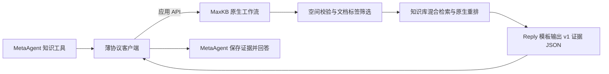

# MaxKB 接入 knowledge-search-v1

推荐复用 MaxKB 原生工作流和应用 API，不增加检索服务。MetaAgent 保留 `knowledge-search-v1`
请求与证据结构，通过 `transport=maxkb-workflow` 转换 HTTP 包装层。
已在本地 MaxKB v2.10.7-lts 完成真实连接及召回验证；业务服务尚未切换。

## 职责和协议



| MetaAgent | MaxKB |
| --- | --- |
| 知识源地址、领域、凭据、超时 | 维护知识库、分块、关联问题与文档标签 |
| 传递完整工具问题与可信空间 | 根据空间、主题和楼层筛选文档 |
| 转换请求/响应包装，校验契约 | 混合检索、重排、证据与来源组装 |
| 调用预算、响应体积限制、证据存储 | 原生应用鉴权、固定空间边界、发布标签与启用状态 |

MetaAgent 不解析楼层，不选择 MaxKB 知识库，不合并原始分数，不执行本地召回或失败回退。
模型不能指定空间、知识库 ID 或检索参数。请求不含患者身份、管理账号和聊天历史。
每次仅发送一条用户消息，不传 `chat_id`，由 MaxKB 创建独立检索会话。

v1 的字段以 [OpenAPI](../src/meta_agent/integrations/knowledge-search-v1.openapi.json) 为准，版本仍为 `1.0.0`。
**该 OpenAPI 描述通用 HTTP 接口；MaxKB 并未因此新增 `/v1/knowledge/search` 路由。**
两种传输方式如下：

| `transport` | URL | HTTP 请求/响应 |
| --- | --- | --- |
| `maxkb-workflow`（MaxKB 推荐） | `/chat/api/{application_id}/chat/completions` | 原生应用消息包装，`message.content` 内为 v1 JSON |
| `http`（默认，保留兼容） | 独立服务的契约 URL | 直接发送 v1 请求，直接返回 v1 响应 |

原生应用请求示例：

```json
{
  "messages": [{"role": "user", "content": "介绍二楼有哪些房间"}],
  "stream": false,
  "form_data": {
    "domain": "product",
    "space_id": "hospital-a",
    "max_context_tokens": 4000,
    "request_id": "request-123"
  }
}
```

`query → messages[0].content`，`domain/scope.space_id/limits.max_context_tokens → form_data`。
`request_id` 同时放入原生表单与 `X-Request-ID`。原始 query 保持不变。
`Authorization: Bearer <MaxKB 应用 API Key>` 使用专用应用凭据，不使用管理账号。
客户端要求单个完整的 assistant 结果、`finish_reason=stop`，再解析和校验 JSON。
普通聊天答案、代码围栏、非 JSON 文本、截断结果都不能成为证据。

Reply 返回示例（内容为示意）：

```json
{
  "status": "ok",
  "context": "[S1] 二楼原文证据……",
  "sources": [{"id": "S1", "title": "二楼场景", "locator": "问诊中心", "ref": "maxkb://knowledge-id/document-id/paragraph-id@update-time"}],
  "gaps": [],
  "trace_id": "maxkb-chat-id"
}
```

| 结果 | 行为 |
| --- | --- |
| `ok` | 保存非空证据、来源与 trace；只表示检索成功，不证明回答已充分 |
| `partial` | 保留证据和缺口；当前模板用于预算截断 |
| `no_evidence` | 正文和来源为空，不扩到其他楼层或其他知识源 |
| 原生 Reply 中的 `KnowledgeErrorResponse` | 明确映射权限拒绝/上游故障，不伪装成无资料 |
| HTTP 错误、超时、畸形响应 | 返回不可用；不重试、不跟随重定向、不回退 |

来源顺序、正文和引用保持 MaxKB 返回值。`ref` 使用原生对象 ID 与更新时间，支持追踪，
**不是不可变的文档归档版本**。`trace_id` 是此次 MaxKB 会话 ID，可在原生对话日志定位节点执行。
本模板由 Reply/Jinja 格式化原文，不经过回答模型。客户端只能校验结构，不能认证任意应用的语义真实性，
因此 URL 必须绑定已审核的检索工作流，不能指向普通聊天应用。

## 部署配置

先按 [原生工作流部署说明](../deployment/maxkb/README.md) 发布应用，再配置实际可达 URL。
当前模板仅覆盖单院场景和界面操作，声明 `help/product`，不宣称已覆盖 `health` 或设备资料。
容器中的 `127.0.0.1` 指向容器自身，不能直接照抄宿主机测试地址。

```dotenv
META_AGENT__KNOWLEDGE_SOURCES=[{"id":"maxkb","description":"已发布的医院楼层场景与界面操作说明","protocol":"knowledge-search-v1","transport":"maxkb-workflow","url":"http://maxkb:8080/chat/api/REPLACE_APP_ID/chat/completions","domains":["help","product"],"scoped_domains":["help","product"],"token_env":"MAXKB_KNOWLEDGE_TOKEN","timeout_seconds":20}]
META_AGENT__KNOWLEDGE_CONTEXT_TOKENS=4000
MAXKB_KNOWLEDGE_TOKEN=replace-with-application-api-key
```

JSON 必须单行；`token_env` 支持进程环境和同一 `.env` 中的变量，进程环境优先。
不要同时配置 `token` 和 `token_env`。缺少可信 `space_id` 时在客户端停止；空间不匹配则由工作流拒绝。
模板使用“一个应用、一个空间”的固定绑定，应用 Key 不可用于检索另一空间。
知识源配置只包含逻辑连接，不包含空间到知识库的映射。

客户端总超时为 20 秒，并受整轮和工具预算限制；响应读取仍有体积上限。
Reply 使用 UTF-8 字节与来源 JSON 长度作保守预算，最多四条来源；不是精确 tokenizer 计数。
小预算可能只够返回缺口。需要更大覆盖面时调业务预算及 MaxKB 节点参数，不在 MetaAgent 补检索。

本机已生成 `.local/maxkb-native/connection.env`，包含验证应用 URL 和私有应用 Key，受 Git 忽略。
只用于显式探测，未修改业务 `.env/.env.local`。本机资料沿用旧目录中的医院中文名作为测试空间，
**接业务环境前必须将应用、文档标签及请求统一绑定实际可信业务 space ID，不能把医院名静默当 UUID 映射。**

旧部署迁移：

1. 删除 `protocol=maxkb`、管理 API 地址及 `maxkb` 对象，换成上面的原生应用配置。
2. 移除 `MAXKB_NATIVE_*` 管理凭据/目录、`PORTFOLIO_*` 和 `KNOWLEDGE_CORPUS_PATH`。
   启用旧本地语料或 Portfolio 路径会被配置校验拒绝。
3. 完成 MaxKB 原生库整理、标签、应用空间绑定、索引与应用发布，再探测。
4. 确认目标环境的空间、权限和保留题通过后，重启 MetaAgent 加载配置。

`KNOWLEDGE_BACKEND=maxkb` 仅兼容旧占位值，不决定路径，可移除。
`KNOWLEDGE_SOURCES=[]` 表示未配置，知识工具返回不可用；其他业务工具继续运行。

## 探测

```powershell
uv run python -m meta_agent.integrations.knowledge_probe --env-file .env --source maxkb --domain product --space-id hospital-a --query "介绍二楼" --check-config
uv run python -m meta_agent.integrations.knowledge_probe --env-file .env --source maxkb --domain product --space-id hospital-a --query "介绍二楼"
```

`--check-config` 完全离线，输出 `network_verified=false`。去掉后才发送一次真实请求。
使用现有容器环境时运行 `docker compose exec meta_agent python -m meta_agent.integrations.knowledge_probe`
并附相同业务参数；省略 `--env-file`。`probe_maxkb.py` 是兼容入口。

| 退出码 | 含义 |
| --- | --- |
| 0 | 配置检查或单次契约调用通过，查看 `check/network_verified` 区分 |
| 2 | 本地配置、凭据或参数无效，未发请求 |
| 3 | HTTP、网络、超时或工作流明确错误 |
| 4 | 响应不符合 v1 契约 |

探测仅输出状态、来源数量、缺口和 trace，不打印凭据、知识正文、查询或上游错误细节。
`no_evidence` 只能证明接口可通，不能证明召回合格。真实结果、样本口径和限制见
[本地验证记录](maxkb-native-verification-20261110.md)。
