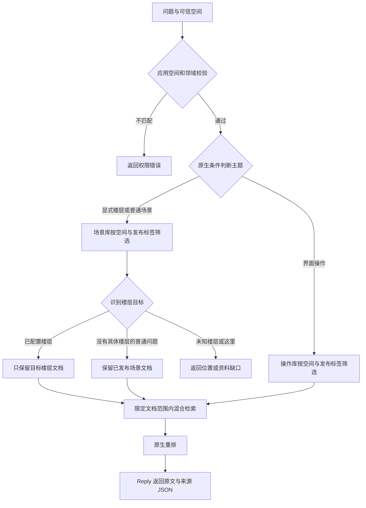

# MaxKB 原生召回实现与过程示例

本文说明如何用 MaxKB 原生能力减少“询问二楼却召回三楼资料”的情况，供知识维护、开发和部署人员实施。
核心做法是：**按楼层组织文档并维护标签，在检索前限定文档范围，再用 Reply 模板返回原文和来源。**

本次召回改进不新增 MaxKB 运行代码，不增加检索服务，不使用 Python 自定义工具节点。
已验证的本机基线包含两个历史文件挂载，具体部署方式见 [部署手册](maxkb-deployment-guide.md)。
MetaAgent 只传递问题和可信空间、适配协议、校验并保存证据；楼层识别、文档筛选、检索与重排由 MaxKB 完成。
`knowledge-search-v1` 统一请求与证据格式，召回改善来自资料和工作流配置，不能仅靠切换协议实现。

当前实现对应 MaxKB `v2.10.7-lts`，已于 2026-11-10 在本地验证，覆盖单院一至五楼和界面操作说明。
本文的 `hospital-a`、`doc-floor-2` 等是便于阅读的示例标识，部署时替换为实际空间与 MaxKB 对象 ID。

## 一 按楼层拆分文档并维护标签

### 文档拆分方式

MaxKB 的原生标签筛选作用于文档。若一份文档同时包含二楼、三楼内容，即使拆成两个段落，
也不能仅靠该文档上的楼层标签保证只检索二楼。应先按楼层拆成独立文档，再在楼层内部按房间或功能分段。

例如，旧资料组织为：

```text
医院说明文档
  一楼 接待大厅
  二楼 问诊中心
  三楼 诊疗中心
  四楼 评估中心
  五楼 数据中心
  屏幕按钮及返回操作
```

调整后分别放入场景库和操作库：

```text
场景库
  一楼 接待大厅文档
  二楼 问诊中心文档
    保留二楼标题、布局及房间说明原文
  三楼 诊疗中心文档
    保留三楼标题、布局及房间说明原文
  四楼 评估中心文档
  五楼 数据中心文档
  医院楼层总览文档

操作库
  屏幕按钮说明文档
  麦克风操作问答文档
  返回社交岛问答文档
```

保留原文事实与标题，不把拆分改写成模型生成的摘要。通用总览单独成文档，不混进单层资料。
旧的多楼层大块可以保留归档，但新工作流不绑定其知识库。
本地实际整理为场景库八份文档、操作库五份文档，共十三份。

### 标签与关联问题

在 MaxKB 的文档标签中维护以下字段：

| 标签 | 示例值 | 用途 |
| --- | --- | --- |
| `space_id` | `hospital-a` | 限定可信医院空间，与应用绑定及请求一致 |
| `floor` | `2` | 标明该文档属于二楼；通用总览和操作说明用 `shared` |
| `release` | `published` | 仅已审核、完成索引的资料进入发布范围；待审核资料用 `draft` |

一份二楼文档的标签示例：

```json
{
  "space_id": "hospital-a",
  "floor": "2",
  "release": "published"
}
```

这些是 MaxKB 原生文档标签，不需要新增数据库表，也不由 MetaAgent 保存副本。
楼层标签依据核对后的标题和内容维护，不根据页码、房间编号或原文中的“通用”字样自动猜测。

在二楼段落的原生“关联问题”中增加“介绍二楼”“2楼有什么”“2F有哪些房间”，
让不同表达关联到同一份原文。关联问题帮助召回，文档标签负责限定范围，两者不能互相替代。

### 发布维护过程示例

| 步骤 | 二楼新资料的状态 | 检索行为 |
| --- | --- | --- |
| 导入与拆分 | `space_id=hospital-a`、`floor=2`、`release=draft` | 不进入已发布范围 |
| 核对与索引 | 核对标题、原文、楼层及关联问题，等待索引完成 | 继续保持 draft |
| 发布 | 移除 draft，添加 `release=published`，文档保持启用 | 可以参与二楼检索 |
| 下线 | 移除 published，或停用文档 | 不再作为可返回证据 |

`release` 是人工维护的业务标签，不是 MaxKB 内置的不可变发布版本。
同一文档不要同时保留 draft 和 published。需要历史留档时保留旧版本文档，避免覆盖后只依赖更新时间追溯。

## 二 原生工作流先限定范围再检索

### 执行顺序



工作流固定绑定批准的知识库和一个业务空间。先验证请求空间，再选择场景或操作主题。
显式楼层表达优先进入场景分支；麦克风、按钮、设置、社交岛等表达进入操作分支。
`help/product` 是粗分类，不直接决定只能查哪个库，因此 `help` 域询问二楼也可以查询场景资料。

### 节点配置对应关系

| 原生节点与配置名 | 关键配置 | 输出用途 |
| --- | --- | --- |
| 条件判断 `scope-guard` | 请求 space_id 等于应用绑定空间，domain 为 help 或 product | 不匹配时返回明确错误 |
| 文档筛选 `scene-published` / `help-published` | 固定知识库，`space_id AND release=published` | 得到允许检索的已发布文档 |
| 条件判断及变量赋值 `floor-1` 至 `floor-5` | 原生正则识别楼层别名，命中后赋对应数字 | 形成目标楼层集合 |
| 文档筛选 `floor-documents` | 引用已发布场景文档，对目标 floor 标签作 OR 筛选 | 得到本轮限定文档 |
| 知识库检索 `search` | 范围引用 `global.document_scope`，模式 blend | 在限定文档内召回段落 |
| 多路召回及重排 `Evidence` | 引用上一步候选，使用已配置的 rerank 模型 | 输出排序后的证据候选 |
| 回复 `reply` | 使用 Jinja 模板格式化原文 | 输出 v1 证据 JSON |

单层问题的条件相当于：

```text
文档属于已批准的场景库
AND space_id = hospital-a
AND release = published
AND floor = 2
```

比较二楼和三楼时，最后一个条件改为 `floor=2 OR floor=3`，空间与发布边界不变。
停用文档或段落仍由原生检索排除。

楼层别名通过原生条件匹配，例如 `二楼/二层/2楼/2F` 均设置 `floor_2="2"`。
其他未命中变量使用 `__none__`，不能设置为空字符串：当前版本会跳过空标签条件，可能放宽筛选范围。
互斥分支汇合处使用 OR，避免等待不会执行的另一条分支。

### 检索与重排参数

| 环节 | 当前值 | 含义 |
| --- | --- | --- |
| 混合检索模式 | `blend` | 复用 MaxKB 原生混合检索 |
| 初召回上限 | 12 条 | 只从已限定文档中获取候选 |
| 初召回阈值 | 0.25 | 当前模型和样本的起始值 |
| 重排上限 | 4 条 | 对候选重新排序并筛选 |
| 重排阈值 | 0.1 | 当前重排模型的起始值 |
| 节点段落字符上限 | 12000 | 限制中间候选内容，最终仍受请求预算约束 |

阈值需要随资料、embedding 和重排模型验证，不能视为跨环境通用值。
本次复用已有模型配置，没有新建模型服务。无资料时不会自动放宽到其他楼层；
模型或网络故障按不可用处理，不伪装成没有资料。

## 三 Reply 模板返回原文证据与来源

Reply 使用原生自定义回复模板，读取 `Evidence.result_list`，取每条候选元数据中的原文及来源信息。
该节点不调用回答模型，不先生成一段回答再把回答作为证据。
完整模板见 [knowledge_reply.jinja](../deployment/maxkb/knowledge_reply.jinja)。

| 返回字段 | 组装方式 |
| --- | --- |
| `context` | 按候选顺序添加 `[S1]` 等编号、标题、定位信息及段落原文 |
| `sources[].id` | 与正文对应的 S1、S2 等引用编号 |
| `sources[].title` | 文档名；缺失时使用段落标题 |
| `sources[].locator` | 段落标题；缺失时使用段落 ID |
| `sources[].ref` | `maxkb://知识库ID/文档ID/段落ID@更新时间` |
| `gaps` | 无资料或预算不足时的缺口说明 |
| `trace_id` | 本次 MaxKB 会话 ID，用于查询原生执行日志 |

模板最多输出四条来源，使用正文 UTF-8 字节数和来源 JSON 长度作保守预算，不是精确 tokenizer 计数。
如果证据需要截断，截取原文前缀并标记 `partial`；若预算无法容纳任何有效来源，则返回 `no_evidence` 和预算缺口。
使用 `tojson` 序列化，避免原文中的引号、换行破坏 JSON。

| 状态 | 当前模板的含义 |
| --- | --- |
| `ok` | 有证据且未因输出预算截断；不代表每个问题条件都已覆盖 |
| `partial` | 有证据，但因预算截断，gaps 说明缺口 |
| `no_evidence` | 无可输出证据，context 为空、sources 为空列表 |

权限错误使用独立错误结构，不能返回 `no_evidence`。来源 ID 与更新时间支持定位，但不等同于不可变原文快照。

### 与 knowledge-search-v1 的连接方式

MetaAgent 配置 `protocol=knowledge-search-v1`、`transport=maxkb-workflow`，
调用 MaxKB 原生 `/chat/api/{application_id}/chat/completions`。
它把 query 放入单条用户消息，其他契约字段放入 `form_data`；从响应的 `choices[0].message.content`
读取 Reply 输出的 JSON，再按 v1 校验。每次调用不携带聊天历史或复用 chat_id。

这不要求 MaxKB 新增 `/v1/knowledge/search` 路由。普通聊天输出不符合证据契约时会被拒绝。
实际字段映射和环境配置见 [接入说明](maxkb-knowledge-search-v1.md)。

## 四 介绍二楼的完整过程示例

### 请求与文档范围

用户询问“介绍二楼”，MetaAgent 从可信应用上下文取得空间，形成 v1 请求：

```json
{
  "query": "介绍二楼",
  "domain": "product",
  "scope": {"space_id": "hospital-a"},
  "limits": {"max_context_tokens": 4000}
}
```

薄客户端转换后的原生应用请求如下，楼层不由 MetaAgent 提取或传参：

```json
{
  "messages": [{"role": "user", "content": "介绍二楼"}],
  "stream": false,
  "form_data": {
    "domain": "product",
    "space_id": "hospital-a",
    "max_context_tokens": 4000,
    "request_id": "example-request-1"
  }
}
```

以下示意文档说明筛选如何缩小范围，文档 ID 为示例，不代表新增了这些测试资料：

| 文档 | 标签 | 本轮处理 |
| --- | --- | --- |
| 二楼问诊中心 | hospital-a、2、published | 保留 |
| 三楼诊疗中心 | hospital-a、3、published | 楼层不匹配，排除 |
| 医院楼层总览 | hospital-a、shared、published | 单层问题不使用总览替代目标层，排除 |
| 二楼待审核更新 | hospital-a、2、draft | 未发布，排除 |
| 另一医院二楼 | hospital-b、2、published | 空间不匹配，排除 |
| 麦克风说明 | 操作库、hospital-a、shared、published | 本题未选择操作库 |

### 逐节点处理

| 步骤 | 输入与操作 | 本例输出 |
| --- | --- | --- |
| 1 空间校验 | 检查 hospital-a 与应用绑定一致，domain 有效 | 允许继续 |
| 2 主题判断 | 问题包含“二楼” | 进入场景分支 |
| 3 发布范围 | 场景库中筛 hospital-a 且 published 的文档 | 去除异空间和待审核资料 |
| 4 目标识别 | 重置楼层变量，匹配二楼别名 | floor_2=2，其余为 __none__ |
| 5 楼层筛选 | 在步骤 3 的结果中按目标 floor 筛选 | 只剩二楼文档 |
| 6 混合检索 | 用完整问题在步骤 5 范围内检索 | 得到二楼原文候选 |
| 7 重排 | 对二楼候选排序和筛选 | 本地实测保留一条二楼来源 |
| 8 Reply | 添加引用编号，保留原文，检查预算并输出 JSON | status=ok，只有 S1 二楼来源 |

三楼文档在检索和重排之前已经排除，因此不会凭相似度挤进这次结果。
如果二楼文档不存在或不满足发布条件，范围为空，流程返回缺口，不改查三楼。

### 返回结果

下面保留本地“介绍二楼”实测返回的正文，来源 ID 和 trace 改为示例标识：

```json
{
  "status": "ok",
  "context": "\n[S1] 二楼  问诊中心 · 二楼  问诊中心\n### [通用][二楼] 问诊中心\n[布局]问诊大厅及环形走廊组成，走廊入口分别在走廊两侧，走廊末端联通，走廊连接各个房间\n问诊大厅右侧，沿走廊依顺序分别为以下问诊室\n物理治疗诊疗室 作业治疗诊疗室 吞咽康复诊疗室 言语康复诊疗室\n问诊大厅左侧，沿走廊依顺序分别为以下诊室\n精神康复诊疗室1 精神康复诊疗室2 运动认知康复诊疗室 情绪康复诊疗室",
  "sources": [
    {
      "id": "S1",
      "title": "二楼  问诊中心",
      "locator": "二楼  问诊中心",
      "ref": "maxkb://scene-kb/doc-floor-2/paragraph-floor-2@example-update-time"
    }
  ],
  "gaps": [],
  "trace_id": "example-maxkb-chat-id"
}
```

此 JSON 是原生 API 的 assistant content 内容；MetaAgent 解包后保存证据和引用，再负责生成面向用户的回答。

## 五 其他分支的过程示例

### 二楼和三楼有什么区别

问题进入场景分支，原生条件同时命中二楼、三楼，设置 `floor_2=2` 和 `floor_3=3`。
在同空间、已发布文档内使用 `floor=2 OR floor=3`，随后混合检索、重排。
本地实测返回 `S1 二楼问诊中心` 与 `S2 三楼诊疗中心`，status 为 ok。
Reply 保留两段原文，比较结论由 MetaAgent 基于原文生成。

当前实现是目标文档并集，没有逐目标证据配额或缺失检测。
复杂多目标问题仍可能只覆盖部分目标，不能把本例通过理解为所有比较题都能完整回答。

### 介绍六楼或介绍这里

“介绍六楼”进入场景分支，但当前模板仅配置一至五楼，不能识别为有效目标；
“介绍这里”没有显式楼层，而 v1 没有当前位置字段。
两种情况均在 `missing-target` 进入缺口分支，直接结束，不扩大检索范围：

```json
{
  "status": "no_evidence",
  "context": "",
  "sources": [],
  "gaps": ["请明确楼层，或该楼层尚无已发布资料。"],
  "trace_id": "example-maxkb-chat-id"
}
```

六楼属于“模板尚未支持”的情况；以后增加六楼资料时，还需同步增加对应条件与标签配置。

### 资料撤下后再询问五楼

本地验证按以下顺序执行，操作对象仅为本次新建的五楼验证文档：

```text
已发布且启用 → 询问五楼 → 命中五楼原文
移除 published → 询问五楼 → 发布筛选无五楼文档 → no_evidence
恢复 published 后停用 → 询问五楼 → 原生检索排除停用文档 → no_evidence
恢复启用 → 询问五楼 → 再次命中五楼原文
```

两次撤下状态都没有返回其他楼层作为替代。

### 粗领域分类与问题主题不同

| 请求 | 原生判断过程 | 实测结果 |
| --- | --- | --- |
| domain=help，query=介绍二楼 | 显式楼层优先，选择场景库，再筛 floor=2 | 只返回二楼 |
| domain=product，query=底下那个麦克风是干什么的 | 命中操作关键词，选择同空间已发布操作文档 | 返回操作库证据，含对应原文问答 |

### 证据预算不足

仍以“介绍二楼”为例，召回范围和重排结果不变，只改变请求的 `max_context_tokens`：

| 请求预算 | Reply 过程 | 本地实测状态 |
| --- | --- | --- |
| 4000 | 可容纳来源和完整原文 | ok |
| 600 | 来源和原文超出保守预算，截取原文前缀，记录预算缺口 | partial，正文与来源的保守计量为 502 |
| 128 | 无法容纳有效正文及来源，保持正文与来源为空 | no_evidence，gaps 指明预算不足 |

502 是模板采用的字节/序列化长度保守计量，不是模型实测 token 数。
预算不足与知识库没有资料都会产生无证据结果，调用方需要同时看 gaps 区分原因。

## 六 实施入口与验收边界

| 需要完成的操作 | 对应文件 |
| --- | --- |
| 维护实际空间、知识库和模型绑定 | [bindings.example.json](../deployment/maxkb/bindings.example.json) |
| 离线生成原生节点配置 | [build_workflow.py](../deployment/maxkb/build_workflow.py) |
| 查看完整节点和连线 | [native-knowledge-search.workflow.json](../deployment/maxkb/native-knowledge-search.workflow.json) |
| 配置 Reply 输出 | [knowledge_reply.jinja](../deployment/maxkb/knowledge_reply.jinja) |
| 导入、发布及切换环境 | [部署说明](../deployment/maxkb/README.md) |
| 配置 MetaAgent 和探测连接 | [knowledge-search-v1 接入说明](maxkb-knowledge-search-v1.md) |

生成器只在部署时生成配置，不作为 MaxKB 运行服务。工作流 JSON 不能直接改后缀作为 `.mk` 导入；
应使用 MaxKB 原生导出文件，目标环境重新绑定知识库与模型。凭据留在部署配置中，不写进本文或代码仓库。

本地固定样本 20/20 通过，其中 12 个单层问题均只有目标层来源；
撤下、停用、越权及预算边界也已验证，详见 [验证记录](maxkb-native-verification-20261110.md)。
这不代表线上准确率，也不覆盖复杂否定、路线语义、跨院同名房间和所有多目标问题。

业务环境尚未切换。正式接入应统一实际可信 space ID、应用绑定和文档标签，
验证目标环境索引与模型，并用业务保留题复核来源正确性和无证据比例。
