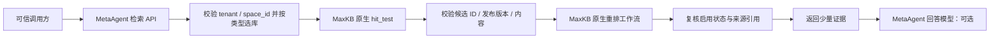

# MaxKB 原生 rerank 方案与本机实验

日期：2026-10-18。当前 dev 基线：`91e91c4`。
这是设计和隔离实验成果；尚未把 rerank 接入运行中的 MetaAgent，也未发布正式 MaxKB 应用。

2026-10-19 已按本设计完成接入和发布，见 [落地记录](maxkb-native-rerank-2026-10-19.md)。
下文保留 10 月 18 日的设计与模拟实验边界，不代表当前部署状态。

## 推荐方案

保留现有 `hit_test` 分类召回，在 MaxKB 中增加一个**只做重排的原生高级智能体工作流**。
它不挂知识库，不使用回答 LLM，不接收用户指定的知识库 ID。
embedding 与 rerank 都使用 MaxKB 模型管理中的原生供应商配置。



现有类型路由、space_id 限制、PDF 物理页码与 MD 标题定位继续留在轻量适配层。
原生工作流只解决当前 `hit_test` 缺少的 rerank，不复制一套导入／分块／向量服务。
部署服务数不增加，也不恢复 bridge。MetaAgent 只增加 HTTP 请求和结果校验，不增加模型 SDK、
本地重排权重或外部模型密钥。

## MaxKB 工作流

执行链为：`开始 → 多路召回（reranker-node）→ 指定回复`。
“多路召回”在这里使用其原生重排能力，输入是 MetaAgent 已召回并校验的候选列表。
图中还有一个仅用于配置的 base-node，不是额外执行服务。

1. 开始节点：问题取 `message`；API 输入为 `candidates` JSON 数组、`request_id` 字符串。
2. 重排节点：问题引用开始节点，待重排内容引用 `global.candidates`。
   在 MaxKB UI 选择原生重排模型，固定 `top_n=6`、`similarity=0`、总引用字符上限 20,000。
3. 指定回复节点：通过原生 Jinja `tojson` 输出结构化结果，不经过 LLM。

```jinja2
{"schema_version":"maxkb-rerank-v1","request_id":{{ global.request_id | tojson }},"results":{{ Rerank.result_list | tojson }}}
```

必须用 `tojson`。原生“引用字段”模式会对列表执行 Python `str(...)`，不能当作严格 JSON 解析。
实验已验证文本含引号、中文和 `{{数据}}` 时仍可往返，不把分块正文作为模板再次执行。

[工作流原型](examples/maxkb-rerank-workflow.json) 已由镜像中的原生执行器加载并执行。
它是原始工作流图，**不是可直接导入的 `.mkapp` 应用导出包**。
正式使用时需在 MaxKB 创建高级智能体、选择实际模型替换占位 UUID、确认 API 输入字段并发布。
UI 创建、发布、应用 Key 认证这部分本次未做端到端验证。

## 模型配置

在 MaxKB「模型管理」配置阿里云百炼供应商的重排模型。镜像自带 `gte-rerank-v2` 条目；
实际模型名应与用户新 API 的支持范围一致，不根据旧配置自动恢复。

| 用途 | 原生驱动接口 | API base 示例 |
|---|---|---|
| 文本 embedding | OpenAI 兼容 `/embeddings` | `https://dashscope.aliyuncs.com/compatible-mode/v1` |
| rerank | DashScope `TextReRank` | `https://dashscope.aliyuncs.com/api/v1` |

这两个地址不能互换。地域、网关和厂商不同应按实际服务填写。
新的供应商密钥只进入 MaxKB 模型管理；MetaAgent 只持有这个重排应用自己的 API Key。
应用 API Key 用来调用 MaxKB，与供应商密钥、MetaAgent 对调用方的服务令牌是不同凭据。
本次没有读取或恢复历史供应商密钥，也没有改动现有 MaxKB 模型条目。

原生 Aliyun reranker 会向供应商发送 `title + content`，并在返回时依照原始文本恢复候选 metadata。
因此候选正文和标题必须是确定的，结果中的 ID 必须属于本次候选集合。

## MetaAgent 的接入边界

独立入口仍是 `POST /v1/knowledge/retrieve`，对调用方不增加新的服务入口。
空间与类型校验必须发生在召回前；所有送往 rerank 的候选也必须通过既有发布与内容校验。

| 类型／组合 | 策略 |
|---|---|
| 纯场景、医院信息 | 原生关键词召回，跳过 rerank |
| 纯 SOP 操作说明 | 原生混合召回，初版跳过 rerank |
| 设备、医学 PDF、康复、技术资料 | 原生混合召回后重排 |
| 混合类型且包含需重排类型 | 合并授权候选后统一重排一次，不比较不同库原始分数 |

建议先设全局候选上限 48，保留各库内部排名并交错取候选；每个候选给重排的正文不超过 1,600 字符。
这些是初始预算值，不是已经证明的最佳参数。对长分块使用确定性窗口，保存本次提交的准确文本和哈希，
原始引用仍由冻结 catalog 生成。

去重分为两步：同一段落 ID 只发一次；相同 `title + content` 的候选只保留一个确定来源，
其余来源留在本地映射，不让原生驱动按相同文本恢复 metadata 时产生歧义。
候选只包含必要的 ID、标题、片段、版本／哈希；页码和标题路径以本地发布为准。

原生 API 使用应用 Key 调用正式发布的工作流。这里镜像的 `chat_path=/chat`，因此路径为：

```http
GET /chat/api/open
Authorization: Bearer <MaxKB应用API-Key>
```

从响应 `data` 取得一个**本次检索独用**的 chat_id，再请求：

```http
POST /chat/api/chat_message/<chat_id>
Authorization: Bearer <MaxKB应用API-Key>
Content-Type: application/json

{
  "message": "检索问题",
  "stream": false,
  "re_chat": false,
  "form_data": {
    "request_id": "本次检索UUID",
    "candidates": [
      {"id":"段落UUID","document_id":"文档UUID","knowledge_id":"授权知识库UUID","title":"标题","content":"已校验片段"}
    ]
  }
}
```

解析外层 `data.content` 中的 JSON，验证 schema、request_id、ID 唯一性、候选成员关系、
回传 metadata 与提交文本的一致性，以及有限数值分数。禁止从结果追加未经授权的新 ID。
不直接把 `page_content` 用作引用正文：原生节点会拼接标题并可能按字符预算截断它。
通过 ID 回到已校验的原候选，再复查原生文档／段落启用状态，最后裁剪 top_k 并生成引用。
有效候选不足时返回实际数量，不使用别的空间或未发布段落凑数。

不复用不同检索的聊天会话，避免历史候选进入另一空间的上下文。
不把应用 Key 交给前端；重排应用不关联任何知识库、不开放普通用户聊天入口。
正式环境应记录已发布的应用版本／工作流摘要，变更发布后重跑最小 smoke。
不把管理端调试接口、私有 `compress_documents` 路由暴露成生产检索 API。

建议复用现有 httpx 连接池，继续禁止环境代理与跳转；最多 2 个重排并发，响应大小受限，
单次工作流初始超时预算 8 秒，同时服从现有检索总超时。这些都是限制配置，非实测云端时延。
客户端超时不保证 MaxKB 或厂商已停止执行，因此默认不自动重试重排请求。

需要新增的运行时配置仅为应用地址、应用 Key 和开关／超时。模型名、供应商地址、
供应商密钥、模型维度、模型驱动继续由 MaxKB 管理。该配置适配代码尚未实现，
不能只向当前 native.json 增加字段就认为已启用 rerank。

## 失败与成本边界

- 空候选：跳过工作流，模型调用为零。
- 对要求重排的类型，工作流鉴权、超时、供应商错误或返回校验失败默认使该阶段失败，
  不以普通排序冒充重排成功。若以后启用可选降级，必须显式返回 partial、原因和 `rerank_applied=false`。
- 成功也必须在引用复核后才报告 `rerank_applied=true`。记录原生工作流请求次数；
  不把它冒充供应商实际请求／重试次数。
- 使用应用工作流会产生 MaxKB 原生会话缓存、执行与聊天记录。它不是完全无状态的 rerank HTTP 服务。
  关闭长期记忆及额外功能，使用原生会话清理设置限制记录保留；实际磁盘增长量尚未测量。

若原生工作流的两次 HTTP 或记录开销最终不可接受，应再比较直接供应商 HTTP 适配；
当前先遵循“原生能力优先、MetaAgent 不管理模型密钥”，不另建服务。

## 本机实验结果和验证范围

固定镜像摘要：`sha256:5ffdafc7956a472ea59ef6820aec5c965282d37c1875109378abae1cbbc2b067`。
使用临时容器、无外部网络、只读根文件系统和临时文件系统；没有挂载业务数据或任何真实凭据。
使用真实 `WorkflowManage`、原生 reranker 节点、原生 Aliyun 驱动、真实 HTTP 到容器内模拟供应商。
模型数据库查找与会话持久化使用测试替身，未测试正式应用 HTTP 认证和发布。

| 少量检查 | 结果 |
|---|---|
| 3 个候选重排，验证顺序及 PDF 页码／MD 标题 metadata | 通过；供应商模拟端收到 1 次请求 |
| 空候选 | 通过；供应商模拟端收到 0 次请求 |
| 供应商返回 503 | 通过；原生工作流返回 500，不冒充成功 |

临时容器退出码 0、OOMKilled=false，已移除。只读运行时的工具沙箱初始化有非致命 chmod 警告，
本工作流未使用任何工具节点。没有声称测得解析峰值、云端延时、内存峰值或重排质量提升。
[机器可读实验结果](maxkb-rerank-lab-2026-10-18.json)。

正式接入后只需补少量真实 smoke：医学 PDF、需重排的 MD 各 1 问验证已知证据能进入前 3 及引用正确，
纯场景 1 问确认跳过重排，错误空间 1 问确认在任何外部请求前拒绝。
模型密钥在 MaxKB 原生界面重新配置后才进行真实厂商调用；不做全量召回或性能评测。

## 官方依据

- [高级智能体与多路召回说明](https://docs.fit2cloud.com/maxkb/user_manual/app/workflow_app/)
- [原生重排节点](https://github.com/1Panel-dev/MaxKB/blob/v2.10.7-lts/apps/application/flow/step_node/reranker_node/impl/base_reranker_node.py)
- [Aliyun 重排驱动](https://github.com/1Panel-dev/MaxKB/blob/v2.10.7-lts/apps/models_provider/impl/aliyun_bai_lian_model_provider/model/reranker.py)
- [聊天 API 路由](https://github.com/1Panel-dev/MaxKB/blob/v2.10.7-lts/apps/chat/urls.py)、[请求字段与执行](https://github.com/1Panel-dev/MaxKB/blob/v2.10.7-lts/apps/chat/serializers/chat.py)
- [指定回复节点](https://github.com/1Panel-dev/MaxKB/blob/v2.10.7-lts/apps/application/flow/step_node/direct_reply_node/impl/base_reply_node.py)

运行中的本机服务仍是此前镜像，未因实验切换成当前 dev；旧 bridge 也未在这次实验中删除。
Docker 恢复过程见 [排查记录](docker-desktop-recovery-2026-10-18.md)。
