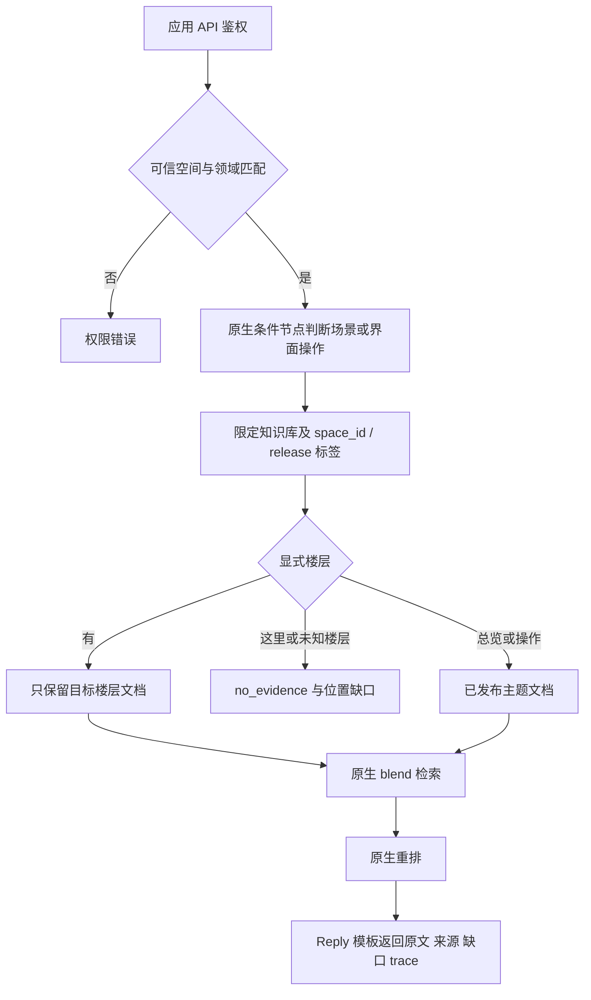

# MaxKB 原生召回改进方案与实施范围

目标是降低“问二楼却使用三楼资料”的概率，不追求所有问法百分百稳定。
已在本地 MaxKB 落实：整理分块、文档标签筛选、原生混合检索、原生重排、Reply 模板输出。
本次召回改进不增加检索服务、不新增 MaxKB 运行代码、不使用 Python/自定义工具节点；MetaAgent 仅做协议适配。
本机基线已有的 Embedding 与启动脚本挂载见 [部署手册](maxkb-deployment-guide.md)，纯官方环境需另行验证。

## 为什么先改文档范围

本地旧资料存在两类问题：一份 Dify 原分块将一至五楼放在同一个 chunk；另一份审核稿虽然分段，
却把多个楼层、总览及界面按钮说明放在同一个文档。仅提高向量相似度或追加重排，不能保证目标楼层。

旧原生适配器曾按库召回 24 条、阈值为 0，并汇总未经校准的不同库分数取前 6 条；
有发布/原文校验，但没有目标楼层限制。此次在两份旧场景库上复现该候选合并方式，
12 个单层问题均出现异楼层片段，且均出现跨多楼层的大块。
这是本地数据与候选实验，不能归因为某次线上事故的唯一原因。

MaxKB 文档筛选原生支持标签条件，知识库节点支持混合检索，多路召回节点支持重排模型。
筛选作用于**文档**，因此必须先按楼层拆文档，再谈标签限制。
[官方工作流说明](https://docs.fit2cloud.com/maxkb/user_manual/app/workflow_app/)

## 已落地的流程

### 资料整理

从已核对的审核稿复制原文，创建独立验证库，不修改旧库：

| 原生知识库 | 文档 |
| --- | --- |
| 场景库 | 一至五楼各一份，通用楼层总览三份，共八份 |
| 界面操作库 | 按钮说明与相关问答，共五份 |

每份文档维护原生标签 `space_id`、`release=published`、`floor=1..5/shared`。
同一文档只包含同一楼层的资料；通用概览不参与单楼层筛选。为楼层段落补充原生关联问题，
例如“介绍二楼”“2楼有什么”“2F有哪些房间”，索引由 MaxKB 自身维护。

`release` 是人工维护的业务标签，并非 MaxKB 内置不可变发布版本。
新资料先保持 draft、完成索引与审查，再加发布标签；下线先移除发布标签或停用文档。
需要严格历史留档时复制新版本文档并保留旧稿，不靠更新时间充当不可变快照。

### 原生工作流

一个应用固定绑定一个可信空间及批准知识库；请求字段不能指定实际知识库。
原生条件节点优先识别显式楼层，再处理按钮、麦克风、设置、社交岛等界面主题。
`help` 和 `product` 均可路由到场景，避免因粗分类为 help 而只查操作库。

楼层别名使用原生正则条件和变量赋值：`二楼/二层/2楼/2F` 指向同一层。
先筛 `space_id AND release`，再在其结果内按目标楼层 OR 筛选；多层比较保留并集。
没有命中文档不放宽范围。“介绍这里”没有 v1 位置上下文，明确返回缺口。

未命中楼层使用 `__none__` 哨兵，不能用空字符串：已核对的版本会跳过空标签条件，可能意外放宽范围。
互斥分支的汇合节点使用 OR，避免原生默认 AND 等待不会执行的分支。
这些均写入 [可生成的原生配置](../deployment/maxkb/README.md)，不运行额外解析程序。

| 参数 | 当前初始配置 |
| --- | --- |
| 检索模式 | `blend`，限制在前一步筛出的文档 |
| 初召回 | 最多 12 条，阈值 0.25 |
| 原生重排 | 复用已有通义 rerank 模型，最多 4 条，阈值 0.1 |
| 输出 | Reply/Jinja 格式化原文，不调用回答模型 |
| 预算 | 按请求预算保守限长，截断标记 `partial`；无法容纳证据则返回缺口 |
| 故障 | 明确不可用；没有自动补检索或重排失败回退 |

阈值是本机模型和小样本起点，不能直接当作跨模型通用推荐值。模型服务复用已有配置，
此次未新增模型容器、网关或后端服务。可不绑定 rerank 生成仅原生检索的配置，
但本文效果数字来自启用重排的版本，不能外推到无重排配置。

## 实测结果

2026-11-10 本地 MaxKB v2.10.7-lts：20 个固定用例通过；其中 12 个单楼层问题全部只返回目标层，
两道二/三楼比较题都保留两层，三道未知位置/楼层题返回 `no_evidence`，三道操作题进入操作库。
另验证空间不匹配拒绝、预算 128/600 时的缺口和截断。
具体来源检查、基线范围与原始产物位置见 [验证记录](maxkb-native-verification-20261110.md)。

这组题用于开发验证，没有独立保留集，不代表线上准确率。新的范围约束、资料拆分、关联问题、阈值和重排
一起变化，本次未做消融实验，不能把收益单独归因于某一个节点。

## 当前边界与后续调整

- 当前是一院一至五楼及界面操作模板。医疗文献、设备资料、其他院区需要另配原生知识库与分支。
- 正则只识别显式目标，不理解复杂否定、纠正、路线角色和“医院有五层吗”等数量歧义。
  多目标使用并集，不保证每个目标都有足够来源，也未实现逐目标缺失检测。
- `ok` 表示有匹配证据，不等于问题的每个条件都已覆盖；MetaAgent 应依据原文与缺口回答。
- v1 未传当前位置，“这里/这层”不能靠客户端猜测。要支持需另行扩展可信上下文契约。
- 文档标签依赖内容维护，错标楼层仍会产生错召回；新文件必须核对标题、原文与标签。
- 模板绑定的服务端应用凭据保护空间边界，不是新增细粒度用户权限系统。

先由业务增加约 60 道标注题，并留出未参与调参的保留题，分别统计错楼层率、正确来源 Hit@4、
无证据比例、多目标覆盖、权限隔离及延迟。优先调整文档、关联问题、原生条件和阈值。
若复杂问法成为主要误差，再考虑 MaxKB 原生参数提取节点；只有原生能力确实不足时才评估额外代码。
业务接入前须完成真实 space ID 绑定与保留题验收，本次没有自动切换业务配置。
